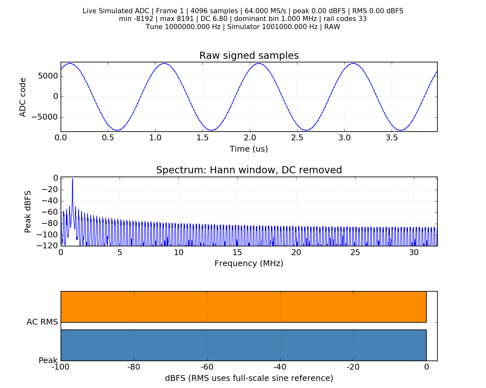

# SmartZynq SP2 HF receiver

This repository contains three independent Vivado projects for the HelloFPGA SmartZynq SP2 V1.3B (XC7Z020) running Xillinux 2.0. They retain the vendor Xillinux platform: HDMI display, Ethernet, SSH and Xillybus continue to be provided by the original PS/PL design.

## Hardware

The receiver uses two readily available boards: a HelloFPGA **SmartZynq SP2**
and an **AD9248-65** dual 14-bit ADC board. The ADC board is the acquisition
front end; the SmartZynq provides the FPGA DSP, Linux control plane, HDMI
display and Ethernet connection. The FPGA generates the 64 MHz sampling clock
and receives the ADC's parallel CMOS data through J6. The current receiver
uses channel A; the second converter channel remains available for later work.

The ADC board is not a complete HF front end by itself. A real antenna input
still needs suitable protection, gain or attenuation, band selection and
anti-alias filtering. The PL turns one digitized RF or IF stream into a tuned
complex channel today; the longer-term architecture is to create several
independent receive slices from that same sampled input.


The whole hardware project is heree: The individual boards are also documented here: https://hackaday.io/project/206722-0-64mhz-multichannel-rx-with-two-commercial-boards.

| Vivado Project | Purpose |
| --- | --- |
| [`board_test`](vivado/projects/board_test/) | Minimal vendor-compatible board and Xillinux test. |
| [`adc_simulator`](vivado/projects/adc_simulator/) | Simulated or external AD9248 capture path. |
| [`hf_ssb_receiver`](vivado/projects/hf_ssb_receiver/) | 64 MS/s DDC, sharp channel filter, USB/LSB demodulation, PCM audio and PS-controlled FT8 simulator. |

Each project has its own `create_project.tcl`, `open_block_design.tcl`, and `build.tcl`. Generated Vivado projects live below that project's `project/` directory and are ignored by Git.

## Receiver architecture

The present implementation is one receiver channel; it is the practical
foundation for the future multi-channel receiver. The FPGA handles the
high-rate conversion work, while Xillinux configures the receiver, presents
the local monitor, and provides audio/IQ data over Ethernet.


## HF receiver quick start

```bash
source /tools/AMDDesignTools2026.1/2026.1/Vivado/settings64.sh
vivado -mode batch -source vivado/projects/hf_ssb_receiver/build.tcl
python3 scripts/shorten_bit_header.py \
  vivado/projects/hf_ssb_receiver/project/verilog/vivado/xillydemo.runs/impl_1/xillydemo.bit \
  build/hf_ssb_receiver-legacy.bit
python3 scripts/deploy_sd.py 192.168.1.126 build/hf_ssb_receiver-legacy.bit
ssh root@192.168.1.126 reboot
```

After boot, copy the receiver utilities once:

```bash
scp scripts/{adc_monitor.py,receiver_control.py,capture_ssb_audio.py,ft8_control.py} root@192.168.1.126:/root/
```

Test the simulated ADC and DDC path with `adc_monitor` first. The board needs
Python 3 with NumPy and Matplotlib (`python3-numpy` and `python3-matplotlib`
packages). Run these commands on the PC to capture one frame per test without
requiring a graphical display:

**Test 1 — Raw ADC snapshot at 64 MS/s**

```bash
ssh root@192.168.1.126 'python3 /root/adc_monitor.py --receiver --source simulated --mode raw --sim-frequency 1001000 --save /root/adc-raw.png'
```



Actual Test 1 output from the board using the simulated ADC: 4096 samples at
64 MS/s, with the dominant FFT bin at 1.000 MHz (15.625 kHz bin spacing).

**Test 2 — Tuned I/Q snapshot at 8 ksample/s**

```bash
ssh root@192.168.1.126 'python3 /root/adc_monitor.py --receiver --source simulated --mode iq --tune 1000000 --sim-frequency 1001000 --save /root/adc-iq.png'
scp root@192.168.1.126:/root/adc-raw.png root@192.168.1.126:/root/adc-iq.png .
```

Each test should print `Frame 1` statistics and save a plot without capture or
format errors. The raw plot should show 4096 samples at 64 MS/s with a signal
near 1.001 MHz; the I/Q plot should show 4096 pairs at 8 ksample/s with a signal
near +1 kHz relative to the tuned frequency. The FT8 simulator changes tones
and includes silence between transmissions, so repeat a capture if it shows
`No signal`.

**Test 3 — Live I/Q monitor on the HDMI desktop**

For an interactive monitor on the board's HDMI desktop (after starting X), run:

```bash
ssh root@192.168.1.126 'DISPLAY=:0 python3 /root/adc_monitor.py --receiver --source simulated --mode iq --tune 1000000 --sim-frequency 1001000'
```

Close the monitor before configuring simulated USB reception and listening on
the Ubuntu PC:

```bash
ssh root@192.168.1.126 'python3 /root/receiver_control.py --source simulated --mode usb --tune 1000000 --sim-frequency 1001000'
ssh -T root@192.168.1.126 'cat /dev/xillybus_read_8' | aplay -t raw -f S16_LE -c 1 -r 8000
```

## Documentation

- [Receiver operation and FT8 simulator](docs/receiver.md)
- [Build, SD deployment and JTAG programming](docs/deployment.md)
- [Design and verification notes](docs/development.md)
- [JTAG reconfiguration lifecycle](docs/jtag-reconfiguration.md)
- [Project map](vivado/projects/README.md)

Earlier experimental projects, intermediate build notes and superseded guides are retained under [`archive/docs/`](archive/docs/). They are historical reference material, not instructions for the current three supported projects.
